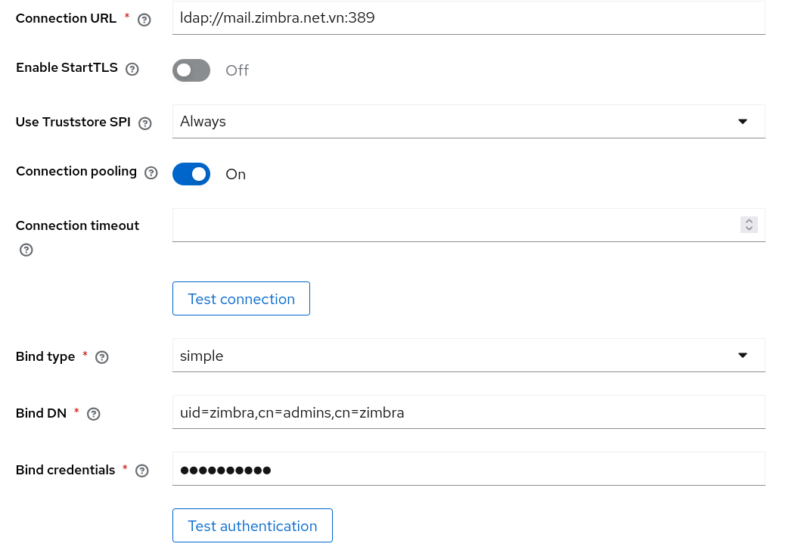
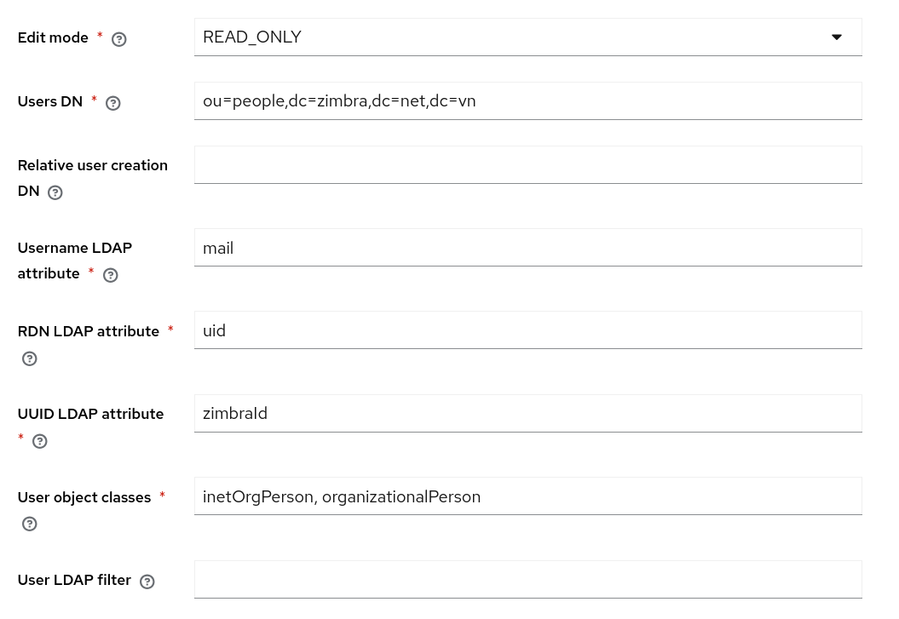
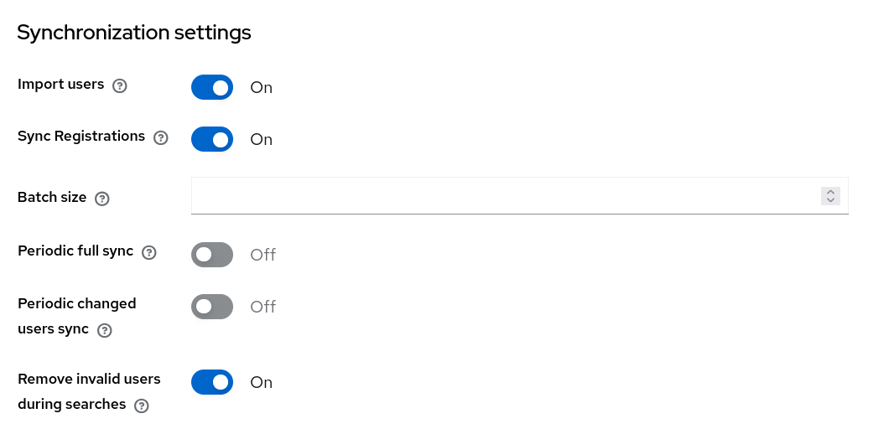
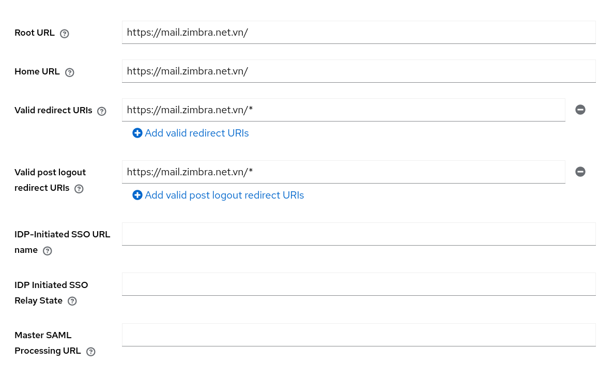
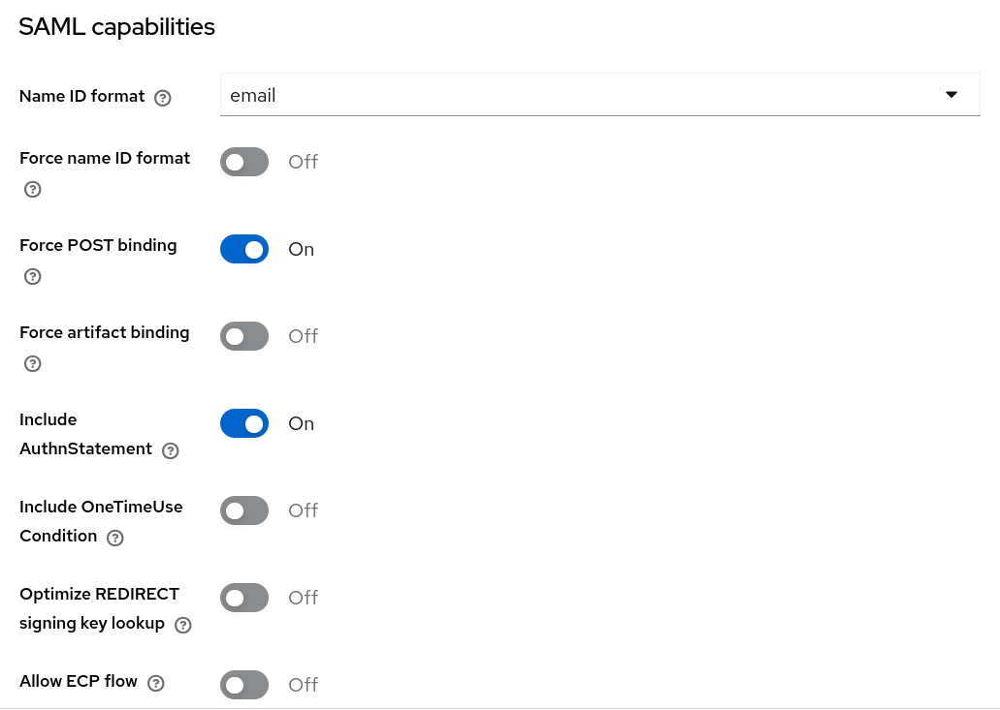
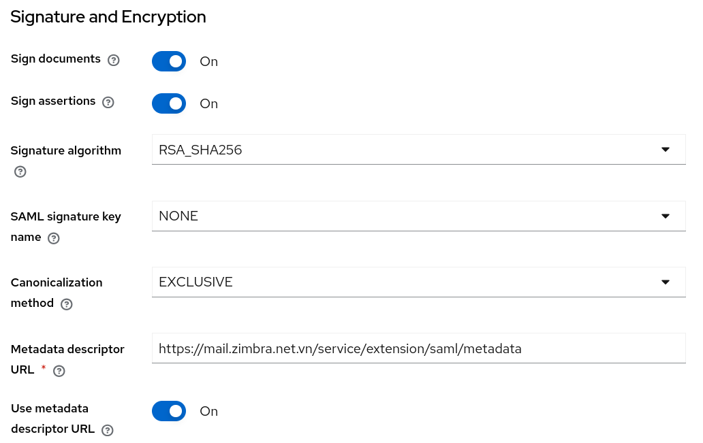
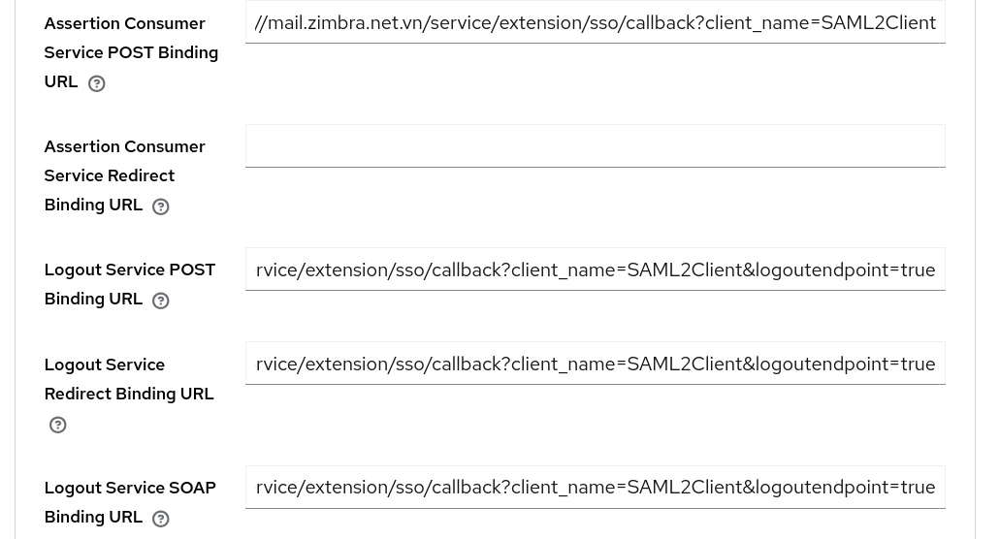
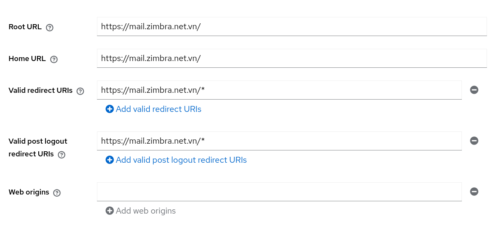

Đăng nhập một lần (Single Sign-On) với Keycloak
===============================================
[Keycloak](https://www.keycloak.org/documentation) là một giải pháp Quản lý Danh tính và Truy cập (Identity and Access Management - IAM) mã nguồn mở, hướng tới các ứng dụng và dịch vụ hiện đại.
Giải pháp này giúp bảo mật các ứng dụng và dịch vụ một cách dễ dàng mà gần như không cần viết thêm mã nguồn.

## Cài đặt Keycloak

### Yêu cầu
* JDK phiên bản 21 trở lên.

### Tải xuống và giải nén phiên bản ổn định mới nhất của Keycloak (hiện tại là 26.0.0)

```shell
$ cd /opt
$ wget https://github.com/keycloak/keycloak/releases/download/26.0.0/keycloak-26.0.0.tar.gz
$ tar -xvzf keycloak-26.0.0.tar.gz
```

### Tạo người dùng quản trị tạm thời

```shell
$ cd /opt/keycloak-26.0.0/
$ ./bin/kc.sh bootstrap-admin user
```

### Chạy máy chủ Keycloak ở chế độ phát triển

```shell
$ cd /opt/keycloak-26.0.0/
$ ./bin/kc.sh start-dev --http-host=your-keycloak-hostname --http-port=8080
```

### Cấu hình User Federation trong Keycloak với Zimbra LDAP
* Truy cập vào Bảng điều khiển quản trị (Administration Console) của Keycloak với tư cách quản trị viên thông qua đường dẫn `http://your-keycloak-hostname:8080/admin` trên trình duyệt web của bạn.
* Tại menu chính, nhấp chọn **Configure > User Federation**.
* Nhấp chọn **Add Provider... -> ldap**.
* Điền thông tin vào biểu mẫu **Connection and authentication settings** (Cài đặt kết nối và xác thực) như hình dưới đây:

* Nhấp vào nút **Test authentication** (Kiểm tra xác thực) để kiểm tra cấu hình LDAP.
* Điền thông tin vào biểu mẫu **LDAP searching and updating** (Tìm kiếm và cập nhật LDAP) như hình dưới đây:

* Điền thông tin vào biểu mẫu **Synchronization settings** (Cài đặt đồng bộ hóa) như hình dưới đây:

* Nhấp vào nút **Save** (Lưu) để thêm cấu hình User Federation qua LDAP.
* Nhấp vào nút **Sync all users** (Đồng bộ hóa tất cả người dùng) để đồng bộ hóa người dùng từ Zimbra sang Keycloak.
* Tại menu chính, nhấp chọn **Manage > Users** để xem danh sách người dùng từ LDAP.

### Cấu hình chứng chỉ SSL không tin cậy cho Keycloak & Zimbra
* Xuất chứng chỉ SSL không tin cậy ra tệp:

```shell
$ openssl s_client -servername your-keycloak-hostname \
  -connect your-keycloak-hostname:443 </dev/null | \
  sed -ne '/-BEGIN CERTIFICATE-/,/-END CERTIFICATE-/p' >/path/to/keycloak.pem
$ openssl s_client -servername your-zimbra-hostname \
-connect your-zimbra-hostname:443 </dev/null | \
sed -ne '/-BEGIN CERTIFICATE-/,/-END CERTIFICATE-/p' >/path/to/zimbra.pem
```

* Trên máy chủ Zimbra, hãy thực thi các lệnh sau với tư cách người dùng `zimbra`:

```shell
$ zmcertmgr addcacert /path/to/keycloak.pem
$ zmprov -l mcf +zimbraCsrfAllowedRefererHosts your-keycloak-hostname
$ zmmailboxdctl restart
```

* Trên máy chủ Keycloak, hãy sao chép tệp `zimbra.pem` vào thư mục `/opt/keycloak-26.0.0/conf/truststores`

### Đăng nhập một lần (SSO) với giao thức SAML
#### Cấu hình SSO cho Zimbra
* Sử dụng trình soạn thảo văn bản để mở tệp **/opt/zimbra/conf/zm.sso.properties**.
* Thiết lập **sso.defaultClient** thành `SAML2Client`.
* Thiết lập **sso.callbackUrl** thành `https://your-zimbra-hostname/service/extension/sso/callback`.
* Thiết lập **saml.callbackUrl** thành `https://your-zimbra-hostname/service/extension/saml/callback`.
* Thiết lập **sso.postLogoutURL** thành `https://your-zimbra-hostname/`.
* Thiết lập **saml.identityProviderMetadataPath** thành `http://your-keycloak-hostname:8080/realms/name-of-your-realm/protocol/saml/descriptor`.
* Khởi động lại dịch vụ mailbox với tư cách người dùng `zimbra` bằng lệnh: `zmmailboxdctl restart`.

#### Tạo client SAML cho Zimbra trên Keycloak
* Sao chép `entityID` từ siêu dữ liệu (metadata) của nhà cung cấp dịch vụ (service provider) tại địa chỉ `https://your-zimbra-hostname/service/extension/saml/metadata`.
* Đăng nhập vào Bảng điều khiển quản trị Keycloak (Keycloak Administration Console) với quyền quản trị viên thông qua trình duyệt web tại địa chỉ `http://your-keycloak-hostname:8080/admin`.
* Trên menu chính, chọn **Configure > Clients**.
* Nhấp vào nút **Create client**, chọn loại client là **SAML**, nhập `entityID` vào trường **Client ID**, sau đó nhấn **Next**.
* Điền thông tin vào biểu mẫu **Login settings** như sau:

* Nhấn **Save** để tạo client SAML mới. * Điền thông tin vào biểu mẫu **SAML capabilities** như sau:

* Điền thông tin vào biểu mẫu **Signature and Encryption** như sau:

* Nhấp vào **Save**.
* Nhấp vào tab **Advanced**.
* Điền các URL từ dữ liệu metadata vào biểu mẫu **Fine Grain SAML Endpoint Configuration** như sau:

* Nhấp vào **Save**.

#### Kiểm thử
* Kiểm thử siêu dữ liệu (metadata) của nhà cung cấp dịch vụ bằng cách truy cập URL `https://your-zimbra-hostname/service/extension/saml/metadata` từ trình duyệt web của bạn.
* Kiểm thử tính năng đăng nhập một lần (Single Sign-On) bằng cách truy cập URL `https://your-zimbra-hostname/service/extension/saml/login` từ trình duyệt web của bạn.
* Kiểm thử tính năng đăng xuất và đăng xuất một lần (Single Logout) bằng cách truy cập URL `https://your-zimbra-hostname/service/extension/sso/logout` từ trình duyệt web của bạn.

#### Thay thế các URL đăng nhập và đăng xuất
* Thực thi các lệnh sau với người dùng `zimbra`:

```shell
$ zmprov mcf zimbraWebClientLoginURL https://your-zimbra-hostname/service/extension/saml/login
$ zmprov mcf zimbraWebClientLogoutURL https://your-zimbra-hostname/service/extension/sso/logout
$ zmmailboxdctl restart
```

### Đăng nhập một lần (Single Sign-On) với giao thức OpenID Connect
#### Tạo client OpenID Connect cho Zimbra trên Keycloak
* Truy cập vào Bảng điều khiển quản trị (Administration Console) của Keycloak với tư cách quản trị viên thông qua đường dẫn `http://your-keycloak-hostname:8080/admin` trên trình duyệt web của bạn.
* Tại menu chính, nhấp chọn **Configure > Clients**.
* Nhấp vào nút **Create client**, chọn loại client là **OpenID Connect**, nhập `your-client-id` vào trường **Client ID**, sau đó nhấp **Next**.
* Bật tùy chọn **Client authentication**, rồi nhấp **Next**.
* Điền thông tin vào biểu mẫu **Login settings** như sau:

* Nhấp **Save** để tạo client OpenID mới.
* Tại mục **Logout settings**, nhập đường dẫn sau vào trường **Front-channel Logout URL**:
`https://your-zimbra-hostname/service/extension/oidc/callback?client_name=OidcClient&logoutendpoint=true`
Chọn **On** cho tùy chọn **Front-channel logout session required**. 
Nhấp **Save** để cập nhật các thiết lập.
* Chuyển sang tab **Credentials**, sau đó nhấp vào nút **Regenerate** để tạo lại client secret (mật mã client).

#### Cấu hình SSO cho Zimbra
* Sử dụng trình soạn thảo văn bản để mở tệp tin **/opt/zimbra/conf/zm.sso.properties**. * Thiết lập **sso.defaultClient** thành `OidcClient`
* Thiết lập **sso.callbackUrl** thành `https://your-zimbra-hostname/service/extension/sso/callback`
* Thiết lập **oidc.callbackUrl** thành `https://your-zimbra-hostname/service/extension/oidc/callback`
* Thiết lập **sso.postLogoutURL** thành `https://your-zimbra-hostname/`
* Thiết lập **oidc.discoveryUri** thành `http://your-keycloak-hostname:8080/realms/name-of-your-realm/.well-known/openid-configuration`
* Thiết lập **oidc.id** thành `Client ID`
* Thiết lập **oidc.secret** thành `Client Secret`
* Khởi động lại dịch vụ mailbox với người dùng `zimbra`: `zmmailboxdctl restart`

**Lưu ý**: Bạn có thể lấy `Client Secret` từ tab **Credentials** (Thông tin xác thực) của ứng dụng khách OpenID Connect mà bạn đã cấu hình.

#### Kiểm thử
* Kiểm thử tính năng đăng nhập một lần (Single Sign-On - SSO) bằng cách truy cập URL `https://your-zimbra-hostname/service/extension/oidc/login` trên trình duyệt web của bạn.
* Kiểm thử tính năng đăng xuất và đăng xuất một lần (Single Logout - SLO) bằng cách truy cập URL `https://your-zimbra-hostname/service/extension/sso/logout` trên trình duyệt web của bạn.

#### Thay thế các URL đăng nhập và đăng xuất
* Thực thi các lệnh sau với người dùng `zimbra`:

```shell
$ zmprov mcf zimbraWebClientLoginURL https://your-zimbra-hostname/service/extension/oidc/login
$ zmprov mcf zimbraWebClientLogoutURL https://your-zimbra-hostname/service/extension/sso/logout
$ zmmailboxdctl restart
```
