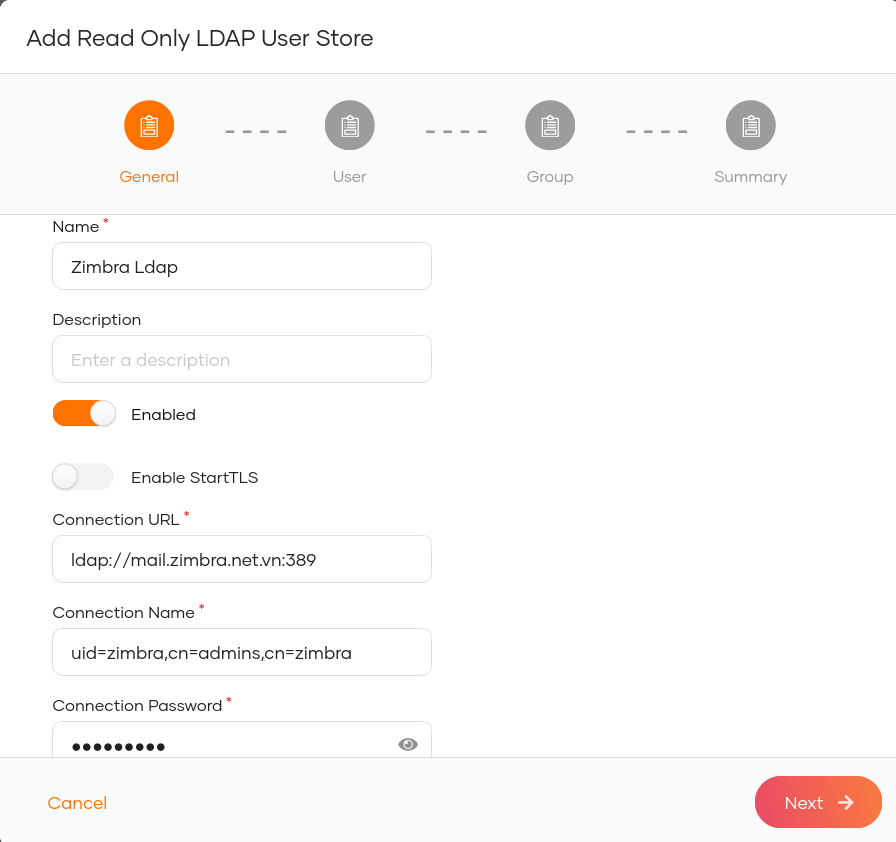
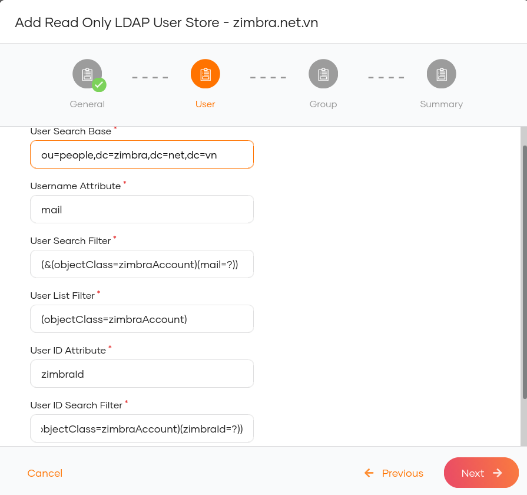
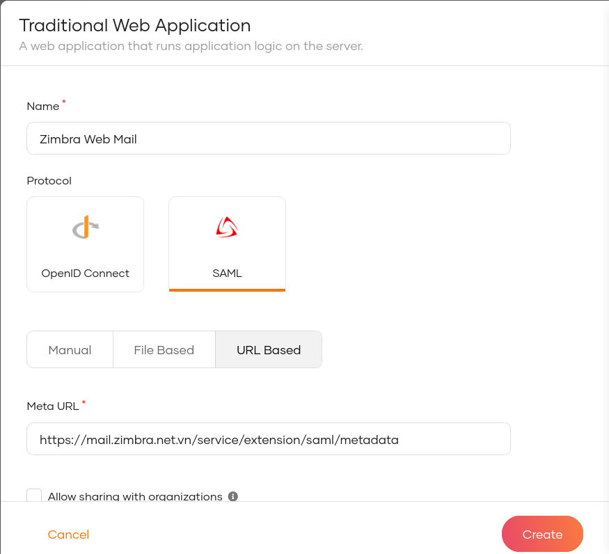
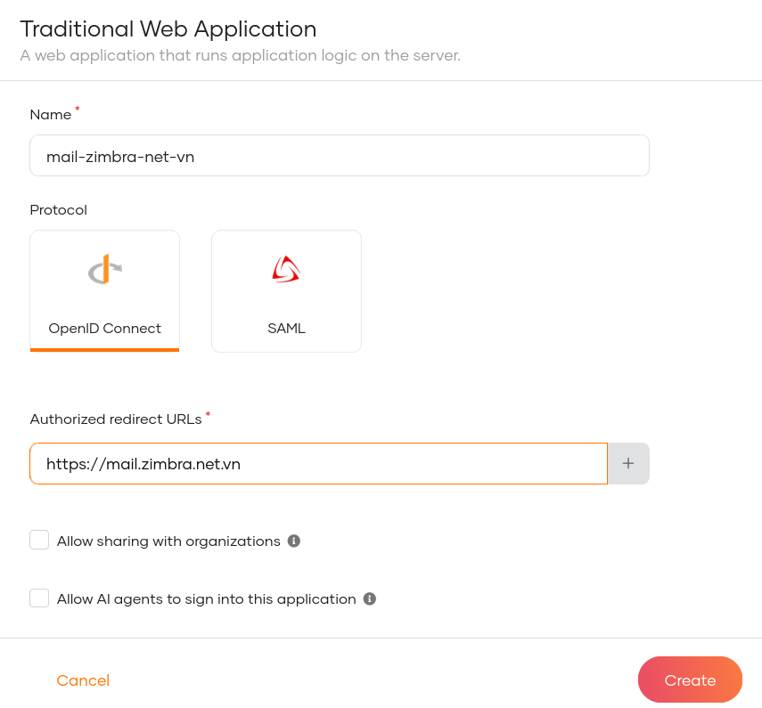

Đăng nhập một lần (Single Sign-On) với WSO2 Identity Server (WSO2 IS)
=====================================================================
[WSO2 IS](https://is.docs.wso2.com) là một sản phẩm quản lý danh tính và truy cập (IAM) mã nguồn mở, vận hành dựa trên API, được thiết kế để hỗ trợ xây dựng các giải pháp IAM cho khách hàng (CIAM) hiệu quả.
Sản phẩm này dựa trên các tiêu chuẩn mở như SAML, OAuth và OIDC, đồng thời cung cấp các tùy chọn triển khai linh hoạt: tại chỗ (on-premise), trên nền tảng đám mây (cloud) hoặc mô hình kết hợp (hybrid).
Nhờ khả năng mở rộng cao, WSO2 IS có thể đáp ứng các yêu cầu phức tạp về IAM.

## Cài đặt WSO2 IS

### Yêu cầu
* JDK phiên bản 21 trở lên.

### Tải xuống và giải nén phiên bản ổn định mới nhất của WSO2 IS (hiện tại là 7.3.0)

```shell
cd /opt
wget https://github.com/wso2/product-is/releases/download/v7.3.0/wso2is-7.3.0.zip
unzip wso2is-7.3.0.zip
```

### Cấu hình triển khai
* Sử dụng trình soạn thảo văn bản để mở tệp **/opt/wso2is-7.3.0/repository/conf/deployment.toml**.
* Chỉnh sửa `hostname` và `node_ip` trong phần `[server]`.

```toml
[server]
hostname = "your id server hostname"
node_ip = "your id server ip address"
```

* Chỉnh sửa `username` và `password` trong mục `[super_admin]`

```toml
[super_admin]
username = "your admin user"
password = "your admin password"
```

* Thêm nội dung sau đây vào gống như dưới đây.

```toml
[cors]
allow_generic_http_requests = true
allow_any_origin = false
allowed_origins = [
    "https://your-zimbra-hostname"
]
allow_subdomains = false
supported_methods = [
    "GET",
    "POST",
    "HEAD",
    "OPTIONS"
]
support_any_header = true
supported_headers = []
exposed_headers = []
supports_credentials = true
max_age = 3600
tag_requests = false
```

### Chạy Identity Server

```shell
$ cd /opt/wso2is-7.3.0/
$ ./bin/wso2server.sh start
```

### Cấu hình kho người dùng (User Store) trong WSO2 IS với Zimbra LDAP
* Đăng nhập vào WSO2 Identity Server Management Console với tư cách quản trị viên (admin) thông qua trình duyệt web tại địa chỉ `https://your-id-server-hostname:9443`.
* Trên menu chính, chọn **User Attributes & Stores > User Stores > New User Store**.
* Chọn **Read Only LDAP**.
* Điền thông tin vào biểu mẫu **Add Read Only LDAP User Store - General** như hình dưới đây:

* Điền thông tin vào biểu mẫu **Add Read Only LDAP User Store - Zimbra Ldap** như hình dưới đây:

* Tắt tùy chọn **Read Group**, sau đó nhấn **Next**.
* Nhấn nút **Finish** để thêm kho người dùng LDAP.
* Trên menu chính, chọn **User Management > Users**.
* Nhấp vào **Users** để liệt kê danh sách người dùng từ LDAP.

### Thêm Service Provider cho máy chủ thư Zimbra
* Đăng nhập vào WSO2 Identity Server Management Console với tư cách quản trị viên (admin) thông qua trình duyệt web tại địa chỉ `https://your-id-server-hostname:9443`.
* Trên menu chính, chọn **Identity > Service Providers > Add**.
* Nhập **Service Provider Name** (Tên nhà cung cấp dịch vụ) và nhấn **Register** để thêm service provider.

### Cấu hình chứng chỉ SSL không tin cậy (untrusted SSL certificate) giữa Zimbra và WSO2 IS
**Trên máy chủ Zimbra:**

* Xuất chứng chỉ SSL không tin cậy ra tệp tin:

```shell
$ openssl s_client -servername your-id-server-hostname \
  -connect your-id-server-hostname:9443 </dev/null | \
  sed -ne '/-BEGIN CERTIFICATE-/,/-END CERTIFICATE-/p' >/path/to/wso2-is.pem
```

* Thực thi các lệnh sau với tư cách người dùng `zimbra`:

```shell
zmcertmgr addcacert /path/to/wso2-is.pem
zmprov -l mcf +zimbraCsrfAllowedRefererHosts your-id-server-hostname
zmmailboxdctl restart
```

**Trên máy chủ WSO2 IS**

* Xuất chứng chỉ SSL không đáng tin cậy ra tệp:

```shell
$ openssl s_client -servername your-zimbra-hostname \
  -connect your-zimbra-hostname:443 </dev/null | \
  sed -ne '/-BEGIN CERTIFICATE-/,/-END CERTIFICATE-/p' >/path/to/zimbra.pem
$ keytool -import -alias your-zimbra-hostname -file /path/to/zimbra.pem \
  -keystore /opt/wso2is-7.3.0/repository/resources/security/client-truststore.p12 \
  -storepass wso2carbon
```

### Đăng nhập một lần (SSO) với giao thức SAML
#### Cấu hình SSO cho Zimbra
* Sử dụng trình soạn thảo văn bản để mở tệp **/opt/zimbra/conf/zm.sso.properties**.
* Thiết lập **sso.defaultClient** thành `SAML2Client`
* Thiết lập **sso.callbackUrl** thành `https://your-zimbra-hostname/service/extension/sso/callback`
* Thiết lập **saml.callbackUrl** thành `https://your-zimbra-hostname/service/extension/saml/callback`
* Thiết lập **sso.postLogoutURL** thành `https://your-zimbra-hostname/`
* Thiết lập **saml.identityProviderMetadataPath** thành `https://your-id-server-hostname:9443/identity/metadata/saml2`
* Khởi động lại dịch vụ mailbox với tư cách người dùng `zimbra` bằng lệnh: `zmmailboxdctl restart`

#### Cấu hình nhà cung cấp dịch vụ (Service Provider) SAML
* Đăng nhập vào WSO2 Identity Server Management Console với quyền quản trị viên thông qua trình duyệt web tại địa chỉ `https://your-id-server-hostname:9443`.
* Tại menu chính (Main menu), chọn **Applications > New Application**, sau đó chọn **Traditional Web Application**.
* Điền thông tin vào biểu mẫu **Traditional Web Application** như hình dưới đây:

* Nhấp vào **Create** để tạo ứng dụng.
* Chuyển sang tab **Protocol**, đánh dấu chọn **Sign SAML responses**, chọn định dạng **NameID format** là
`urn:oasis:names:tc:SAML:1.1:nameid-format:emailAddress`,
chọn phương thức đăng xuất (**Logout method**) là `Front Channel HTTP Post`,
thiết lập cả **Single logout response URL** và **Single logout request URL** thành
`https://your-zimbra-hostname/service/extension/sso/callback?client_name=SAML2Client&logoutendpoint=true`
đánh dấu chọn **Enable Attribute Profile**. Sau đó, nhấp vào **Update**. * Nhấp vào tab **User Attributes**, thêm thuộc tính **Email** là `http://wso2.org/claims/emailaddress`,
chọn **Subject attribute** là `http://wso2.org/claims/emailaddress`. Nhấp vào **Update**.

#### Kiểm thử
* Kiểm thử siêu dữ liệu (metadata) của nhà cung cấp dịch vụ (service provider) bằng cách truy cập URL `https://your-zimbra-hostname/service/extension/saml/metadata` từ trình duyệt web của bạn.
* Kiểm thử tính năng đăng nhập một lần (Single Sign-On - SSO) bằng cách truy cập URL `https://your-zimbra-hostname/service/extension/saml/login` từ trình duyệt web của bạn.
* Kiểm thử tính năng đăng xuất và đăng xuất một lần (Single Logout - SLO) bằng cách truy cập URL `https://your-zimbra-hostname/service/extension/sso/logout` từ trình duyệt web của bạn.

#### Thay thế các URL đăng nhập và đăng xuất
* Thực thi các lệnh sau với người dùng `zimbra`:

```shell
$ zmprov mcf zimbraWebClientLoginURL https://your-zimbra-hostname/service/extension/saml/login
$ zmprov mcf zimbraWebClientLogoutURL https://your-zimbra-hostname/service/extension/sso/logout
$ zmmailboxdctl restart
```

### Đăng nhập một lần (SSO) với giao thức OpenID Connect
#### Cấu hình nhà cung cấp dịch vụ (Service Provider) OpenID Connect
* Đăng nhập vào WSO2 Identity Server Management Console với tư cách quản trị viên bằng cách truy cập URL `https://your-id-server-hostname:9443` trên trình duyệt web của bạn.
* Tại menu chính (Main menu), nhấp vào **Applications > New Application**, sau đó chọn **Traditional Web Application**.
* Điền thông tin vào biểu mẫu **Traditional Web Application** như sau:

* Tại tab **Protocol**, nhập `https://your-zimbra-hostname` vào mục **Allowed origins**; nhập `https://your-zimbra-hostname/service/extension/oidc/callback?client_name=OidcClient&logoutendpoint=true` vào mục **Backchannel Logout Url**, rồi nhấp **Update**.
* Tại tab **User Attributes**, chọn **Email**, đánh dấu vào ô **Assign alternate subject identifier**, chọn `Email` cho mục **Subject attribute**, rồi nhấp **Update**.

#### Cấu hình SSO cho Zimbra
* Sử dụng trình soạn thảo văn bản để mở tệp tin **/opt/zimbra/conf/zm.sso.properties**. * Thiết lập **sso.defaultClient** thành `OidcClient`
* Thiết lập **sso.callbackUrl** thành `https://your-zimbra-hostname/service/extension/sso/callback`
* Thiết lập **oidc.callbackUrl** thành `https://your-zimbra-hostname/service/extension/oidc/callback`
* Thiết lập **sso.postLogoutURL** thành `https://your-zimbra-hostname/`
* Thiết lập **oidc.discoveryUri** thành `https://your-id-server-hostname:9443/oauth2/oidcdiscovery/.well-known/openid-configuration`
* Thiết lập **oidc.id** thành `Client ID`
* Thiết lập **oidc.secret** thành `Client secret`
* Khởi động lại dịch vụ mailbox với người dùng `zimbra`: `zmmailboxdctl restart`

**Lưu ý**: Bạn có thể lấy `OAuth Client Key` và `OAuth Client Secret` từ mục **Inbound Authentication Configuration -> OAuth/OpenID Connect Configuration** trên nhà cung cấp dịch vụ OpenID Connect mà bạn đã cấu hình.

#### Kiểm thử
* Kiểm thử tính năng đăng nhập một lần (Single Sign-On - SSO) bằng cách truy cập URL `https://your-zimbra-hostname/service/extension/oidc/login` trên trình duyệt web của bạn.
* Kiểm thử tính năng đăng xuất và đăng xuất một lần (Single Logout - SLO) bằng cách truy cập URL `https://your-zimbra-hostname/service/extension/sso/logout` trên trình duyệt web của bạn.

#### Thay thế các URL đăng nhập và đăng xuất
* Thực thi các lệnh sau với người dùng `zimbra`:

```shell
$ zmprov mcf zimbraWebClientLoginURL https://your-zimbra-hostname/service/extension/oidc/login
$ zmprov mcf zimbraWebClientLogoutURL https://your-zimbra-hostname/service/extension/sso/logout
$ zmmailboxdctl restart
```
